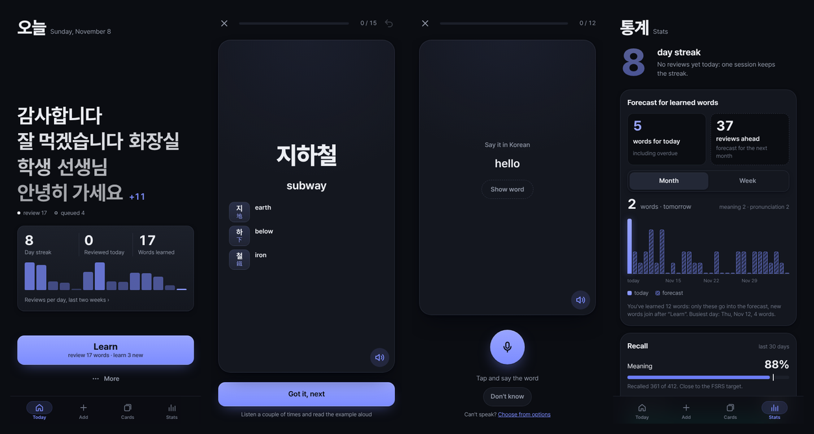

# KQuiz

A self-hosted app for learning Korean vocabulary: flashcards with spaced repetition, pronunciation practice scored sound by sound, and cards you can add straight from a chat with Claude.

It is a dark, mobile-first PWA that works in any modern browser (iPhone, Android, desktop) and installs to the home screen. One server hosts it for you and, if you like, a few friends by invite.



## Features

- **Learn new words a few at a time.** Words you add wait in a queue, in the order you added them (say, one lesson with your tutor after another). A Learn session introduces a few, then makes you use them: pick the Korean for the translation, build the word from syllables, say it aloud, type what you hear. Mistakes come back at the end of the session.
- **Spaced repetition with FSRS.** Each card has its own schedule for meaning, pronunciation and listening ([ts-fsrs](https://github.com/open-spaced-repetition/ts-fsrs)). Once there are enough reviews, the FSRS parameters are fitted to your own history, and you pick a target retention.
- **Pronunciation scoring.** Record a word and see which sounds were off (initial, vowel, batchim), with a tip on how to fix each one. Also shadowing of example sentences with an intonation chart, and listening drills on sounds that are easy to confuse (ㄱ/ㅋ/ㄲ, ㅓ/ㅗ).
- **Natural audio.** Every word and example is voiced once on the server with [Supertonic](https://github.com/supertone-inc/supertonic) TTS and cached.
- **Rich cards.** Translation, pronunciation, three example sentences, notes laid out by kind (don't confuse, opposite, expressions, literally…), tags, Sino-Korean roots that link a word to its word family, and pairs of similar words that the quizzes keep apart. Set phrases are learned whole and built from their pieces.
- **Add cards from Claude.** KQuiz is an MCP server: connect it to Claude as a custom connector and ask it to add the words from your lesson. Claude can add and edit cards, never delete them. Translations go in whatever language your deck uses; the interface itself is in English.
- **Hard cards, stats and a forecast** of upcoming reviews.
- **Passkey sign-in only**, no passwords. The owner can invite friends, each with their own deck and a card limit.
- **Built to be cheap and safe to host**: one small VPS, rate limits and size caps everywhere, the scoring service never exposed to the internet.

## How it is built

| Path | What it is |
|---|---|
| `apps/web` | The PWA: React, Vite, TypeScript |
| `apps/api` | Backend: Hono on Node, SQLite (Drizzle), FSRS, passkeys (SimpleWebAuthn), the MCP server with OAuth for Claude |
| `services/scorer` | Internal Python service (FastAPI): pronunciation scoring with a wav2vec2 phone model, and TTS |
| `deploy` | Docker Compose, Caddy, firewall, backups and auto-update for a single server |

Design and architecture: [docs/PLAN.md](docs/PLAN.md). Self-hosting guide: [docs/DEPLOY.md](docs/DEPLOY.md). API reference and environment variables: [apps/api/README.md](apps/api/README.md), [services/scorer/README.md](services/scorer/README.md).

## Running locally

You need Node 22+ and pnpm 10.

```sh
pnpm install
pnpm dev        # API on :8787, web on :5173 (proxies /api)
pnpm test
pnpm build
```

Open http://localhost:5173. On first start the API prints a one-time setup code to its log; enter it to register your passkey. If the API isn't running, the dev build falls back to a mock with sample cards, which is handy for working on the UI.

Pronunciation scoring and TTS need the Python service, which runs separately: see [services/scorer/README.md](services/scorer/README.md). Without it the app still works, with the browser's own Korean voice and without scoring.

## Self-hosting

A VPS with 4 GB of RAM and Ubuntu 24.04 is enough. Docker Compose runs Caddy (automatic HTTPS), the API and the scorer; a systemd timer pulls updates and backs the database up every night. See [docs/DEPLOY.md](docs/DEPLOY.md).

To connect Claude, add `https://<your-domain>/mcp` as a custom connector in Claude's settings and sign in with your passkey when asked.

## Status

KQuiz is a personal project shared as is, under the [MIT License](LICENSE). It teaches Korean only, the interface is in English, and issues and pull requests are welcome.
